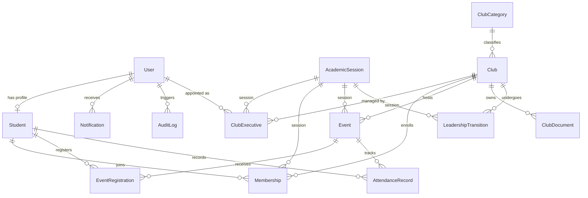
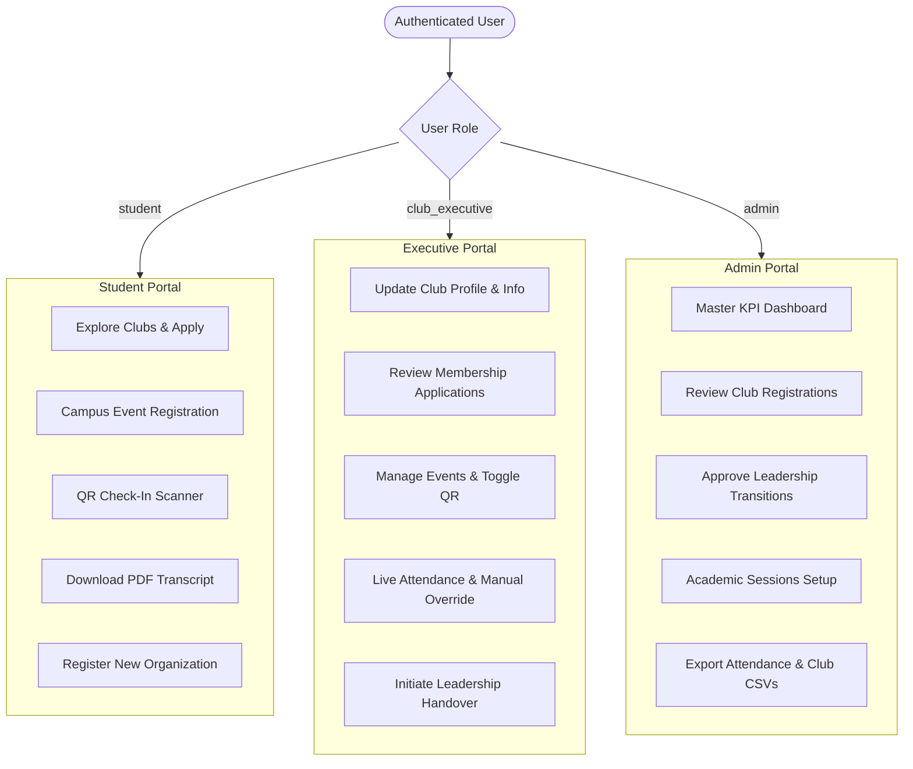
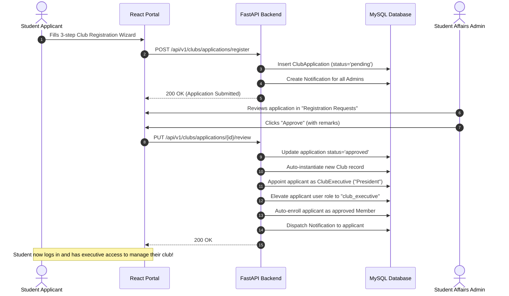
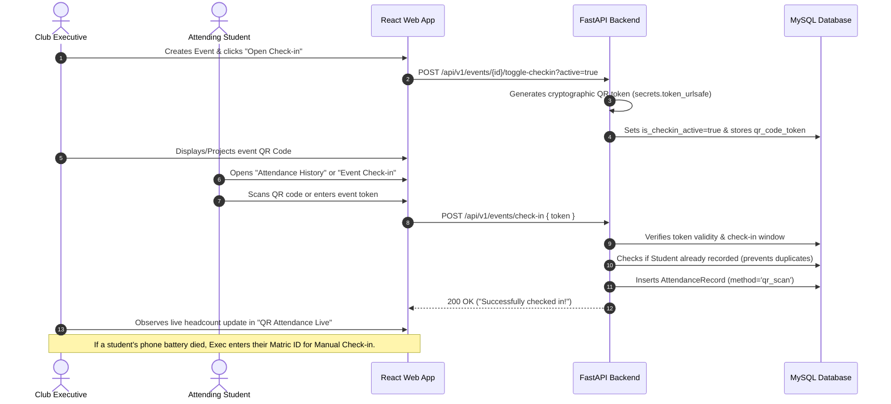

# AUN Club & Student Organization Management System
## Full-Stack System Architecture & Technical Documentation

---

## 1. Executive Summary

The **AUN Club & Student Organization Management System** is an enterprise-grade full-stack web application developed for the American University of Nigeria (AUN). The system streamlines co-curricular engagement, organization registration, membership management, event attendance verification via dynamic QR codes, leadership transitions, and official transcript generation.

### Tech Stack Overview

```mermaid
flowchart LR
    subgraph Client ["Frontend (Client Layer)"]
        UI["React 19 + TypeScript"]
        Tailwind["Tailwind CSS v4"]
        Router["React Router v7"]
        Query["TanStack React Query"]
    end

    subgraph Server ["Backend (API Layer)"]
        FastAPI["FastAPI (Python 3.11+)"]
        Auth["JWT + Passlib/Bcrypt"]
        ORM["SQLAlchemy 2.0 ORM"]
        PDF["ReportLab PDF Engine"]
    end

    subgraph Data ["Persistence (Database Layer)"]
        MySQL[("MySQL 8.0+ Database")]
    end

    Client -- "HTTPS / JSON + Bearer JWT" --> Server
    Server -- "PyMySQL / Connection Pool" --> Data
```



---

## 2. System Architecture

The application adopts a decoupled **Client-Server Architecture**:
- **Presentation Tier**: A Single Page Application (SPA) providing role-based user interfaces.
- **Application Tier**: A RESTful API implementing business rules, role-based access control (RBAC), and validation.
- **Data Tier**: A relational database maintaining relational integrity, foreign keys, and audit trails.

---

## 3. Database Layer (MySQL & SQLAlchemy)

The database schema consists of **15 entities** modeled in `backend/app/models/models.py`.

### Entity Relationship Diagram



### Core Tables & Responsibilities

| Table Name | Description | Key Attributes |
|---|---|---|
| `users` | Central identity table for authentication and core RBAC roles. | `id`, `email`, `hashed_password`, `first_name`, `last_name`, `role` (`student`, `club_executive`, `admin`), `is_active` |
| `students` | Extended academic metadata for student accounts. | `id`, `user_id` (FK), `student_id` (AUN Matric), `major`, `school`, `graduation_year`, `cgpa` |
| `academic_sessions` | Institutional academic semesters/sessions. | `id`, `name`, `start_date`, `end_date`, `is_current` |
| `club_categories` | Taxonomical grouping (e.g. Academic, Social, Sports). | `id`, `name`, `description`, `icon`, `is_active` |
| `clubs` | Student organizations recognized by the university. | `id`, `name`, `category_id` (FK), `description`, `mission`, `meeting_schedule`, `logo_url`, `is_active`, `is_suspended` |
| `club_applications` | Formal requests to establish a new club. | `id`, `applicant_id` (FK), `club_name`, `category_id` (FK), `status` (`pending`, `approved`, `rejected`), `admin_remarks` |
| `club_executives` | Executive officer rosters per club and session. | `id`, `club_id` (FK), `user_id` (FK), `position` (President, VP, etc.), `is_active` |
| `memberships` | Student enrollments in clubs. | `id`, `club_id` (FK), `student_id` (FK), `status` (`pending`, `approved`, `rejected`, `left_club`), `position` |
| `events` | Calendar activities and workshops. | `id`, `club_id` (FK), `title`, `venue`, `event_date`, `qr_code_token`, `is_checkin_active`, `capacity` |
| `event_registrations`| Pre-event attendance registrations. | `id`, `event_id` (FK), `student_id` (FK), `status` |
| `attendance_records` | Verified event check-in records. | `id`, `event_id` (FK), `student_id` (FK), `checked_in_at`, `method` (`qr_scan`, `manual`) |
| `leadership_transitions`| Formal executive handover requests. | `id`, `club_id` (FK), `outgoing_executive_id` (FK), `incoming_executive_id` (FK), `status`, `transition_date` |
| `notifications` | Internal push alerts dispatched to users. | `id`, `user_id` (FK), `title`, `message`, `link`, `is_read`, `notification_type` |
| `audit_logs` | Immutable operational logs for administrative tracking. | `id`, `user_id` (FK), `action`, `entity_type`, `entity_id`, `details`, `timestamp` |

---

## 4. Backend Architecture (FastAPI & Python)

The backend provides high-performance asynchronous API endpoints structured modularly under `backend/app/`.

### Directory Structure

```text
backend/
├── app/
│   ├── api/
│   │   └── routes/
│   │       ├── admin.py         # Institutional analytics, user management, audit logs, CSV exports
│   │       ├── auth.py          # Registration, JWT token issuance, identity (/me)
│   │       ├── clubs.py         # Directory, applications, executive roster, categories
│   │       ├── events.py        # Event CRUD, QR generation, manual/QR check-in
│   │       ├── leadership.py    # Handover initiation, review, and permission assignment
│   │       ├── memberships.py   # Student club applications, approval workflows
│   │       └── students.py      # Dashboard stats, transcripts (JSON & PDF via ReportLab)
│   ├── core/
│   │   ├── config.py        # Pydantic BaseSettings, database URLs, JWT configuration
│   │   └── security.py      # Direct bcrypt hashing and HMAC-SHA256 JWT operations
│   ├── db/
│   │   └── session.py       # SQLAlchemy engine & session factory (get_db dependency)
│   ├── models/
│   │   └── models.py        # SQLAlchemy Declarative Models
│   ├── schemas/
│   │   └── schemas.py       # Pydantic v2 data transfer objects (DTOs)
│   └── main.py              # Application entrypoint, CORS configuration, API router mounting
├── seed.py                  # Database initialization and mock data seeder
└── requirements.txt         # Python dependencies
```

### Core Backend Modules & Workflows

1. **Authentication & Role Authorization**:
   - Uses OAuth2 Bearer Tokens with JSON Web Tokens (JWT).
   - Direct password hashing using `bcrypt` (72-byte safe, bypassing legacy Passlib bugs).
   - Granular RBAC dependencies: `get_current_user` and `require_role([UserRole.ADMIN, UserRole.CLUB_EXECUTIVE])`.

2. **Dynamic QR Code Attendance Engine**:
   - Event coordinators toggle check-in mode (`is_checkin_active`).
   - The system generates signed event tokens (`AUN_EVENT:<id>:<token>`) and returns an in-memory PNG QR code via `backend/app/api/routes/events.py`.
   - Students check in via the client, verifying active status and eliminating duplicate check-in entries.

3. **Co-Curricular Transcript Generator**:
   - Aggregates verified club memberships, leadership tenures, and verified attendance histories.
   - Built-in PDF renderer in `backend/app/api/routes/students.py` using `ReportLab`, producing printable transcripts bearing official university styling.

4. **Automated Leadership Handover**:
   - Outgoing executives propose successors.
   - Upon Student Affairs Admin approval, the system atomically updates `ClubExecutive` active states and elevates the incoming user's role to `CLUB_EXECUTIVE`.

---

## 5. Frontend Architecture (React, TypeScript & Tailwind)

The frontend is a single-page application built with **React 19**, **TypeScript**, and **Tailwind CSS v4**, bundled via **Vite**.

### Directory Structure

```text
frontend/src/
├── api/
│   └── client.ts            # Axios client with JWT interceptors & token auto-attachment
├── components/
│   └── layout/
│       └── DashboardLayout.tsx  # Responsive navigation bar and dynamic role-based sidebar
├── pages/
│   ├── admin/               # 8 Admin pages (Analytics, Clubs, Registrations, Events, Sessions, etc.)
│   ├── executive/           # 5 Executive pages (Profile, Membership Approvals, QR Live, Handover)
│   ├── public/              # Login, Register, Public Club & Event Directories
│   └── student/             # 6 Student pages (Overview, Transcript, My Clubs, Attendance, Notifications)
├── store/
│   └── AuthContext.tsx      # Global auth state, session persistence, logout handling
├── App.tsx                  # Client-side routing with ProtectedRoute HOC
└── main.tsx                 # Entrypoint & React root mounting
```

### Three Role-Based Portals



### Visual & UI Standards
- **Institutional Colors**: AUN Deep Navy (`#002147`), Royal Blue (`#2563eb`), Slate Gray, and Clean White.
- **State & Caching**: TanStack Query handles server-state synchronization with invalidation strategies on mutations.
- **Security**: Token interceptor attaches `Authorization: Bearer <token>` to requests and flushes invalid sessions on HTTP 401.

---

## 6. How It Works: Core Workflows & Step-by-Step Use Cases

The system solves the operational friction of paper forms, manual attendance sheets, untracked club registrations, and lost co-curricular records. Below is how the system works across its primary real-world use cases.

### Use Case 1: Proposing & Approving a New Student Club



### Use Case 2: Club Membership Application & Review

1. **Student Browsing**:
   - A student navigates to **Explore Clubs** (`/clubs`), searches or filters by category (e.g. *Academic & Technical*, *Recreation & Sports*).
   - They click **"Join Club"**, enter their motivation/application reason, and submit.
2. **Backend Validation & Notification**:
   - API checks:
     - User has a valid student profile (Admins cannot apply).
     - Student does not already have an active or pending membership in that club.
   - Saves `Membership` record with `status='pending'`.
   - Sends notification to all active executives of that club.
3. **Executive Decision**:
   - Club executives open **Membership Requests** (`/executive/membership-requests`).
   - They view applicant names, emails, student IDs, and application statements.
   - Clicking **Approve** or **Reject** triggers `PUT /api/v1/memberships/{id}/review`:
     - Updates status to `approved`.
     - Records `joined_at` timestamp.
     - Dispatches notification to the student. The club now appears under the student's **My Enrolled Clubs**.

---

### Use Case 3: Event Creation, Dynamic QR Check-In & Attendance



---

### Use Case 4: Co-Curricular Transcript Generation

1. **Student Request**:
   - A student visiting `/student/transcript` can view their institutional extracurricular transcript.
2. **Data Aggregation**:
   - When the student clicks **"Download Official PDF Transcript"**, the browser calls `GET /api/v1/students/transcript/pdf`.
   - The backend queries:
     - Official student profile (Matriculation ID, school, major, graduation year).
     - Verified club memberships & leadership positions held.
     - Complete verified event attendance history with dates and host organizations.
3. **Official PDF Generation**:
   - Using the Python `ReportLab` engine, the backend compiles a formatted PDF on the fly:
     - American University of Nigeria institutional header & navy styling.
     - Executive leadership achievements and verification stamps.
     - Direct binary stream download (`media_type="application/pdf"`).

---

### Use Case 5: Executive Leadership Handover

1. **Initiation**:
   - An outgoing President or executive goes to `/executive/handover`.
   - Selects the target position (e.g. *President*, *Treasurer*), enters the incoming student's email, and adds transition notes.
2. **Review & Automatic Permission Delegation**:
   - The transition is submitted with `status='pending'`.
   - The Student Affairs Administrator inspects the handover in `/admin/leadership`.
   - When the Admin clicks **Approve**:
     - The outgoing executive's tenure is marked `is_active=false` with `relinquished_at=now`.
     - The incoming student's `ClubExecutive` record is activated.
     - The incoming student's user account is promoted to `CLUB_EXECUTIVE` permissions.
     - All audit logs and history are permanently preserved.

---

## 7. Security & Data Integrity

1. **Zero Raw Password Storage**: Passwords are cryptographically salted and hashed using standard `bcrypt`.
2. **Access Control Enforcement**: Frontend route gating via `<ProtectedRoute />` is purely visual; **FastAPI dependency injection enforces authorization on every single API request**.
3. **Pydantic Data Validation**: Strict type-checking and deserialization prevent SQL injection and schema mismatch attacks.
4. **Relational Constraints**: Cascading rules on foreign keys ensure that deleting or archiving entities preserves relational integrity without leaving orphaned records.

---

## 8. Setup & Execution Guide

### Prerequisites
- Python 3.11+
- Node.js 18+ and npm
- MySQL Server 8.0+

### Database Initialization
```sql
CREATE DATABASE aun_clubs CHARACTER SET utf8mb4 COLLATE utf8mb4_unicode_ci;
```

### Backend Startup
```powershell
# In project root
.\venv\Scripts\Activate.ps1
$env:PYTHONPATH="C:\Users\DELL\Documents\Coding Projects\Club management system"
python backend/seed.py      # Seed schema and initial demo users
uvicorn backend.app.main:app --reload --port 8000
```

### Frontend Startup
```powershell
cd frontend
npm.cmd run dev
```

### Default Credentials
- **Student Affairs Admin**: `admin@aun.edu.ng` / `Admin123!`
- **Club Executive**: `tunde.adebayo@aun.edu.ng` / `Student123!`
- **Student**: `chidi.okonkwo@aun.edu.ng` / `Student123!`
